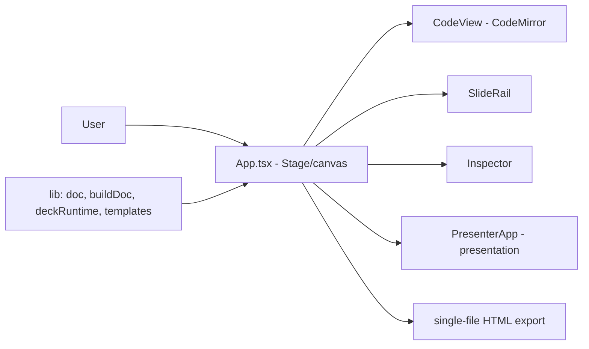

# slidestage

**English** · [Português (Brasil)](README.md)

[](#) [](#) [](#) [](#) [](#) [](#)

## What it is

**SlideStage** is an **HTML slide editor** with a visual canvas and a code editor: build the deck by dragging/positioning slides on the bench, edit each slide's HTML/CSS/JS with CodeMirror, and present live with a **presenter mode** (and a `presenter.html` file). It exports a single HTML file for publishing on GitHub Pages. It is a creative-authoring desktop tool (Tauri) whose web app also runs in the browser.

> Note: the previous README described a **finance dashboard** (Recharts, AI assistant) — it does not exist in this repository. Corrected.

## Status

Under development (version 0.1.2), working and tested (46 tests). Build validated.

## Features

- **Visual editing canvas** (`Stage`): lays out slides on a gridded bench.
- **Code editor** (`CodeView`, CodeMirror 6): edits each slide's HTML, in sync with the canvas.
- **Presenter mode** (`PresenterApp`, `presenter.html`): presents the deck with an overlay.
- **Slide rail** (`SlideRail`), **toolbar** and a properties **inspector**.
- **Slide templates** (`TemplateModal`) and a **help modal**.
- **Single-file HTML export** for publishing.
- **High-contrast dark theme** (no toggle), decisions in `DESIGN.md`.
- **Tauri 2** (desktop app) with a Vite web fallback.

## Architecture

React/TS with per-function modules; the logic in `src/lib` (doc, buildDoc, deckCss, deckRuntime, templates, editor, notes) is separated and tested. Components live in `src/components`. `presenter.html` is a second entry for the presenter mode.



## Stack

- React 18, TypeScript 5.x
- Vite 5, CodeMirror 6
- Vitest 2 + jsdom (tests)
- Tauri 2 (desktop)

## Repository layout

```
slidestage/
├── src/
│   ├── App.tsx · main.tsx
│   ├── components/   # Stage, CodeView, Controls, Inspector, SlideRail,
│   │                 # Toolbar, TemplateModal, PresenterApp, PresentOverlay, et al.
│   ├── lib/          # doc, buildDoc, deckCss, deckRuntime, templates,
│   │                 # editor, notes (+ tests)
├── presenter.html    # presenter-mode entry
├── index.html
├── DESIGN.md         # design direction (dark theme)
├── exemplos/exemplo-externo.html
├── package.json · vite.config.ts
└── (SlideStage.exe committed)  # see HYGIENE
```

## Prerequisites and installation

Node.js (npm). For the desktop app, [Rust + Tauri prerequisites](https://tauri.app/start/prerequisites/).

```bash
git clone https://github.com/KelvinOliveiraCode/slidestage.git
cd slidestage
npm install
```

## How to run

```bash
npm run dev          # web app in the browser
npm test             # vitest run
npm run build        # production build (tsc --noEmit && vite build)
npm run preview      # preview the build
# desktop: npm run tauri dev
```

## Tests and quality

Real run (verified by the agent):

```bash
npm test
# 46 passed (5 files): notes 5, doc 17, templates 6, editor 11 (+)
npm run build
# built in 3.73s
```

There is no CI configured in this repository.

## Technical decisions and trade-offs

- **In-sync canvas + code editor**: visual-first and code-first users work on the same document.
- **Single high-contrast dark theme** (no toggle): a tool-authoring decision documented in `DESIGN.md`.
- **Testable logic separated in `src/lib`**: deck generation/parsing validated without UI.
- **Single-file HTML export**: the published deck is self-contained and easy to host.

## Known limitations and roadmap

- Under development (v0.1.2); the full desktop flow depends on the Rust/Tauri toolchain.
- No CI configured.
- A `SlideStage.exe` binary is committed (move to Releases — see `HYGIENE.md`).

## Development process

An individual project by Kelvin Oliveira, built with orchestrated AI agents and reviewed by the author. The editor architecture, the presenter mode and the review are the author's.

## License and author

This repository has **no license file** (no `LICENSE`). Copyright (c) Kelvin Rebelo de Oliveira.

**Author**: [Kelvin Oliveira](https://github.com/KelvinOliveiraCode) · [Portfolio](https://kelvinoliveiracode.github.io/portfolio/)
