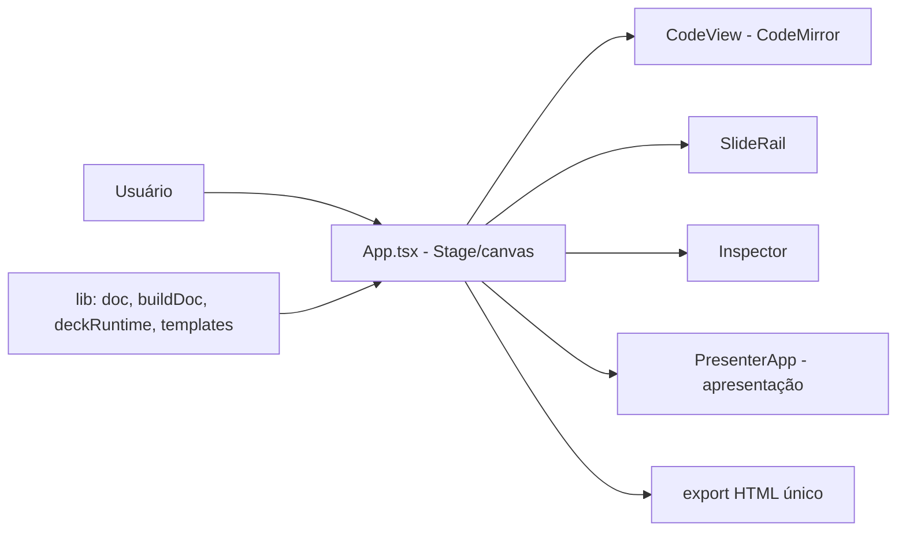

# slidestage

[English](README.en.md) · **Português (Brasil)**

[](#) [](#) [](#) [](#) [](#) [](#)

## O que é

**SlideStage** é um **editor de slides em HTML** com canvas visual e editor de código: monte a apresentação arrastando/posicionando slides na bancada, edite o HTML/CSS/JS de cada slide com CodeMirror e apresente ao vivo com um **modo apresentador** (e arquivo `presenter.html`). Exporta um HTML de arquivo único para publicar no GitHub Pages. É uma ferramenta de autoria criativa desktop (Tauri) com a mesma web app no navegador.

> Nota: o README anterior descrevia um **dashboard financeiro** (Recharts, assistente IA) — não existe neste repositório. Corrigido.

## Status

Em desenvolvimento (versão 0.1.2), funcional e testado (46 testes). Build validado.

## Funcionalidades

- **Canvas de edição visual** (`Stage`): monta slides na bancada com grade.
- **Editor de código** (`CodeView`, CodeMirror 6): edita o HTML de cada slide, sincronizado com o canvas.
- **Modo apresentador** (`PresenterApp`, `presenter.html`): apresenta a deck com overlay.
- **Rail de slides** (`SlideRail`), **toolbar** e **inspetor** de propriedades.
- **Templates de slide** (`TemplateModal`) e **modal de ajuda**.
- **Export de arquivo único HTML** para publicação.
- **Tema escuro de alto contraste** (sem toggle), decisões em `DESIGN.md`.
- **Tauri 2** (app desktop) com fallback web (Vite).

## Arquitetura

React/TS com módulos por função; a lógica em `src/lib` (doc, buildDoc, deckCss, deckRuntime, templates, editor, notes) é separada e testada. Componentes em `src/components`. `presenter.html` é um segundo entry para o modo apresentador.



## Stack

- React 18, TypeScript 5.x
- Vite 5, CodeMirror 6
- Vitest 2 + jsdom (testes)
- Tauri 2 (desktop)

## Estrutura do repositório

```
slidestage/
├── src/
│   ├── App.tsx · main.tsx
│   ├── components/   # Stage, CodeView, Controls, Inspector, SlideRail,
│   │                 # Toolbar, TemplateModal, PresenterApp, PresentOverlay, et al.
│   ├── lib/          # doc, buildDoc, deckCss, deckRuntime, templates,
│   │                 # editor, notes (+ testes)
├── presenter.html    # entry do modo apresentador
├── index.html
├── DESIGN.md         # direção de design (tema escuro)
├── exemplos/exemplo-externo.html
├── package.json · vite.config.ts
└── (SlideStage.exe commitado)  # ver HYGIENE
```

## Pré-requisitos e instalação

Node.js (npm). Para desktop, [Rust + Tauri pré-requisitos](https://tauri.app/start/prerequisites/).

```bash
git clone https://github.com/KelvinOliveiraCode/slidestage.git
cd slidestage
npm install
```

## Como executar

```bash
npm run dev          # web app no navegador
npm test             # vitest run
npm run build        # build de produção (tsc --noEmit && vite build)
npm run preview      # pré-visualiza o build
# desktop: npm run tauri dev
```

## Testes e qualidade

Execução real (verificada pelo agente):

```bash
npm test
# 46 passed (5 arquivos): notes 5, doc 17, templates 6, editor 11 (+)
npm run build
# built in 3.73s
```

Não há CI configurado neste repositório.

## Decisões técnicas e trade-offs

- **Canvas + editor de código sincronizados**: quem prefere visual e quem prefere código trabalham no mesmo documento.
- **Tema escuro único de alto contraste** (sem toggle): decisão de ferramenta de autoria documentada em `DESIGN.md`.
- **Lógica testável separada em `src/lib`**: geração/parse de decks validados sem UI.
- **Export de arquivo único HTML**: o deck publicado é autocontido, fácil de hospedar.

## Limitações conhecidas e roadmap

- Projeto em desenvolvimento (v0.1.2); fluxo desktop completo depende do toolchain Rust/Tauri.
- Sem CI configurado.
- Há um binário `SlideStage.exe` commitado (move para Releases — ver `HYGIENE.md`).

## Processo de desenvolvimento

Projeto individual de Kelvin Oliveira, construído com agentes de IA orquestrados e revisado pelo autor. A arquitetura do editor, o modo apresentador e a revisão são do autor.

## Licença e autor

Este repositório **não possui arquivo de licença** (sem `LICENSE`). Copyright (c) Kelvin Rebelo de Oliveira.

**Autor**: [Kelvin Oliveira](https://github.com/KelvinOliveiraCode) · [Portfólio](https://kelvinoliveiracode.github.io/portfolio/)
